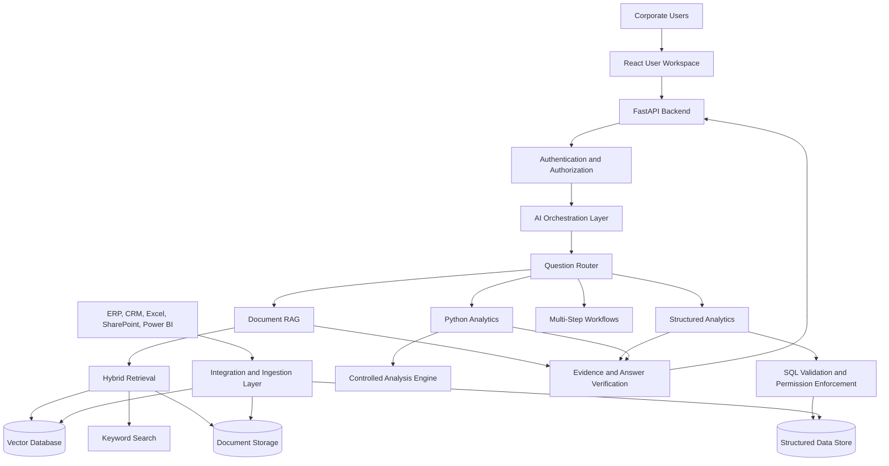

# Corporate Finance & Sales Intelligence Copilot
# System Architecture Specification

**Version:** 1.0  
**Status:** Initial Architecture Proposal  
**Architecture Type:** Modular Enterprise AI System

---

## 1. Purpose

This document defines the initial logical architecture of the Corporate Finance & Sales Intelligence Copilot.

The architecture is designed to support secure enterprise data integration, document intelligence, structured financial and sales analytics, AI-assisted workflows, evidence-backed answers, and management reporting.

The architecture is provisional. Technology choices and deployment details will be validated during implementation and stakeholder discovery.

## 2. Architectural Principles

The system follows these principles:

1. Security must be enforced at the backend and data layers.
2. Structured analytics must use deterministic query and calculation methods.
3. Document question answering must use evidence-based retrieval.
4. AI-generated answers must be traceable to supporting evidence.
5. The system must preserve source data lineage.
6. Components should be modular and independently testable.
7. Data access must be read-only by default.
8. The LLM must not directly control unrestricted database access.
9. AI workflows should be implemented only when their complexity justifies orchestration.
10. Development must initially use synthetic data.
11. Technology choices should remain replaceable where practical.
12. The Copilot must not replace authoritative company systems.

## 3. High-Level Architecture

### 3.1 Architecture Overview

The system consists of the following major layers:

1. User Interface
2. Backend API
3. Authentication and Authorization
4. AI Orchestration
5. Document Intelligence and RAG
6. Structured Analytics
7. Analytical Processing
8. Data Integration and Ingestion
9. Data Storage
10. Security, Governance and Observability

### 3.2 Logical Architecture



## 4. Component Responsibilities

### 4.1 Frontend

**Proposed technology:** React + TypeScript

Responsibilities:

- User authentication interface
- Chat workspace
- Conversation management
- Data visualization
- Tables and KPI cards
- Citation presentation
- Document preview
- Report downloads
- User feedback
- Permission-aware interface

The frontend must not be considered a security enforcement boundary.

### 4.2 Backend API

**Proposed technology:** FastAPI

Responsibilities:

- API endpoints
- Authentication integration
- Input validation
- Authorization enforcement
- Conversation management
- AI workflow invocation
- Report generation
- Error handling
- Logging and request tracing

Initial API modules:

- Chat API
- Document API
- Analytics API
- Report API
- User API
- Administration API

### 4.3 AI Orchestration Layer

Responsibilities:

- Determine the question category
- Select the appropriate analytical capability
- Coordinate multiple tools when required
- Manage workflow state
- Handle failures and retries
- Apply verification steps
- Produce the final response

The initial implementation will favor deterministic routing and controlled workflows.

LangGraph will be evaluated for workflows requiring stateful, multi-step orchestration.

### 4.4 Document Intelligence and RAG

Responsibilities:

- Document ingestion
- Text extraction
- OCR
- Cleaning and normalization
- Chunking
- Metadata extraction
- Embedding generation
- Hybrid search
- Retrieval fusion
- Reranking
- Permission-aware retrieval
- Citation generation
- Evidence verification

Provisional technologies:

- Docling / PyMuPDF
- BGE embeddings
- Qdrant
- BM25 keyword retrieval
- BGE reranker

### 4.5 Structured Analytics Engine

Responsibilities:

- KPI definitions
- Business metric interpretation
- SQL generation or query construction
- SQL validation
- Permission-aware execution
- Aggregations
- Period comparisons
- Budget-versus-actual analysis
- Sales target analysis
- Receivables analysis
- Data validation

Structured analytics must use approved data sources and deterministic calculations.

### 4.6 Analytical Processing Engine

Responsibilities:

- Statistical analysis
- Trend analysis
- Variance decomposition
- Forecasting
- Anomaly detection
- Customer and product analysis
- Controlled Python execution
- Visualization data generation

Provisional technologies:

- pandas
- NumPy
- SciPy
- statsmodels
- scikit-learn
- Plotly

### 4.7 Data Integration Layer

Responsibilities:

- Connect to authorized enterprise sources
- Extract structured and unstructured data
- Support incremental ingestion
- Validate extracted data
- Transform and normalize
- Detect duplicates
- Maintain lineage
- Track refresh status
- Handle failures
- Synchronize document permissions

Integration methods will depend on the actual company systems and approved access methods.

### 4.8 Data Storage Layer

Initial storage candidates:

| Storage | Purpose |
|---|---|
| PostgreSQL | Application data, metadata, structured analytical data |
| Qdrant | Vector search and document retrieval |
| File/object storage | Original and processed documents |
| Redis (optional) | Caching, temporary state, background processing |

Storage technologies will be selected and validated based on requirements and deployment constraints.

## 5. Data Flow Architecture

### 5.1 Structured Data Flow

```text
Enterprise Source
       |
       v
Data Extraction
       |
       v
Data Validation
       |
       v
Transformation and Normalization
       |
       v
Structured Data Storage
       |
       v
Analytics Query
       |
       v
Permission Enforcement
       |
       v
SQL Execution
       |
       v
Calculation and Validation
       |
       v
Evidence-Backed Answer
```

### 5.2 Document Data Flow

```text
Document Source
       |
       v
Document Extraction / OCR
       |
       v
Text Cleaning
       |
       v
Chunking
       |
       v
Metadata and Permissions
       |
       v
Embedding Generation
       |
       v
Vector and Keyword Indexing
       |
       v
Hybrid Retrieval
       |
       v
Reranking
       |
       v
Evidence Selection
       |
       v
LLM Answer Generation
       |
       v
Citation and Verification
```

## 6. Question Processing Architecture

### 6.1 Question Routing

The system will initially categorize user questions into the following types:

| Question Category | Processing Route |
|---|---|
| Document question | RAG |
| Financial KPI | Structured Analytics |
| Sales KPI | Structured Analytics |
| Comparison or variance | Structured Analytics + calculations |
| Statistical analysis | SQL + Python |
| Cross-domain investigation | Multiple controlled tools |
| Management report | Multi-step workflow |

### 6.2 Cross-Domain Workflow

Example:

**User question:** Why did revenue increase while profitability declined?

Processing:

1. Identify the question as cross-domain analysis.
2. Determine the required metrics and periods.
3. Retrieve authorized financial and sales records.
4. Calculate revenue, cost, profit, and margins.
5. Analyze product, customer, region, discount, and cost contributions.
6. Retrieve relevant supporting documents where necessary.
7. Validate calculations and supporting evidence.
8. Generate a structured explanation.
9. Provide tables, charts, citations, limitations, and findings.

## 7. Security Architecture

Security controls must be enforced across the architecture.

### Identity and Access

- Authentication
- Role-based access control
- User permission validation
- Session management

### Data Access

- Read-only database access
- Row-level permissions
- Column-level restrictions where required
- Document access control
- Permission-aware retrieval

### AI Security

- Prompt injection protection
- Restricted tool execution
- SQL validation
- Controlled analytical execution
- Evidence verification
- Data leakage prevention

### Infrastructure Security

- Secrets management
- Encryption
- Network security
- Secure deployment configuration

### Audit and Monitoring

- User activity logging
- Data access logs
- AI workflow tracing
- Error monitoring
- Performance metrics

## 8. Evidence and Answer Verification

Answers should be verified before being returned to the user.

### Document Answers

Citations should include relevant source metadata such as:

- Document name
- Page or section
- Relevant passage
- Source version
- Retrieval reference

### Numerical Answers

Evidence should include:

- Source dataset or table
- Relevant date range
- Metric definition
- Query or calculation method
- Result
- Data freshness

### Analytical Answers

The system should distinguish:

- Verified numerical findings
- Evidence-supported explanations
- Interpretations
- Hypotheses
- Recommendations
- Limitations

## 9. Provisional Technology Stack

| Layer | Candidate Technology |
|---|---|
| Frontend | React, TypeScript, Vite |
| UI | Tailwind CSS, shadcn/ui |
| Charts | Plotly or Recharts |
| Backend | FastAPI |
| Programming | Python |
| Database | PostgreSQL |
| Vector Search | Qdrant |
| Embeddings | BGE family |
| Reranking | BGE reranker |
| Document Processing | Docling, PyMuPDF, OCR |
| AI Orchestration | LangGraph where justified |
| Analytics | pandas, NumPy, SciPy |
| ML / Forecasting | scikit-learn, statsmodels |
| Cache / Queue | Redis (optional) |
| Object Storage | S3-compatible or approved storage |
| Deployment | Docker |
| Testing | pytest, frontend testing tools |
| Monitoring | Structured logs, metrics, tracing |
| AI Evaluation | Custom evaluation, RAGAS where appropriate |

These are candidates, not final decisions.

## 10. Deployment Architecture

Deployment options requiring further evaluation:

- On-premises infrastructure
- Private cloud
- Hybrid deployment
- Approved enterprise cloud

Deployment decisions will depend on:

- Corporate security policies
- Data residency
- AI model availability
- Hardware
- Budget
- Infrastructure capabilities
- IT requirements

Development will initially use local infrastructure and synthetic datasets.

## 11. Architecture Decision Records

The following decisions require further evaluation:

| ID | Decision | Status |
|---|---|---|
| ADR-001 | Frontend technology | Proposed React |
| ADR-002 | Backend technology | Proposed FastAPI |
| ADR-003 | Structured data storage | PostgreSQL candidate |
| ADR-004 | Vector database | Qdrant candidate |
| ADR-005 | AI orchestration | Evaluate LangGraph |
| ADR-006 | LLM deployment strategy | Local vs approved cloud |
| ADR-007 | Enterprise deployment | Pending |
| ADR-008 | Data integration strategy | Pending source discovery |
| ADR-009 | Authentication provider | Pending IT discovery |
| ADR-010 | Document retrieval strategy | Hybrid RAG proposed |

## 12. Architecture Risks

| Risk | Mitigation |
|---|---|
| Unauthorized data exposure | Backend permissions and source-level security |
| Incorrect SQL | Validation and deterministic execution |
| Incorrect KPI definitions | Approved semantic definitions |
| Unsupported AI claims | Evidence verification |
| Stale data | Freshness tracking |
| Integration failures | Retries and controlled error handling |
| Prompt injection | Untrusted-content isolation |
| Complex architecture too early | Incremental implementation |
| Vendor dependency | Abstraction where practical |
| Poor retrieval | Evaluation and iterative improvement |

## 13. Architecture Acceptance Criteria

The initial architecture is complete when:

- All major system components are identified.
- Component responsibilities are documented.
- Structured and unstructured data flows are defined.
- AI orchestration and question routing are explained.
- Security enforcement points are identified.
- Evidence and verification are included.
- Provisional technology choices are documented.
- Unresolved architecture decisions are recorded.
- The architecture supports all major business use cases.

---

**End of Document**
